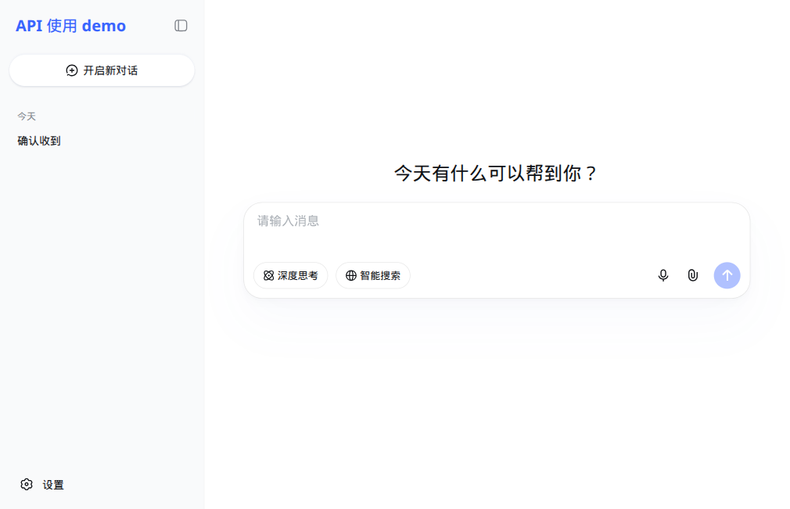

# dsh-chat-demo

An **unofficial** integration that embeds the official
[DeepSeek chat-demo](https://github.com/deepseek-ai/chat-demo) inside the
[DeepSeek Harness](https://github.com/deepseek-ai/deepseek-harness) Web UI, with
a bottom-right launcher, a right-sidebar panel, and — most importantly — the
same API configuration and model catalog the local DSH already uses.

> This project is community-built. It is not affiliated with, sponsored by, or
> endorsed by DeepSeek. “DeepSeek” and “DeepSeek Harness” are used only to
> identify the software being integrated. See
> [THIRD_PARTY_NOTICES.md](THIRD_PARTY_NOTICES.md).




## Features

- **Bottom-right quick entry** in the DSH window: a `Chat` pill opens the chat
  demo in a right-sidebar tab; the adjacent `↗` button opens the same page in a
  new browser tab.
- **Right-sidebar panel** that hosts the full chat-demo UI (conversations,
  deep thinking, smart search, markdown, KaTeX, Mermaid, attachments, speech),
  with a toolbar for “open in new page” and reload.
- **Shared API configuration** — the browser never asks for an API key. The
  plugin's Host half resolves the credential DSH itself uses (DeepSeek account
  sign-in first, then the `DEEPSEEK_API_KEY` credential reference) and injects
  it into a same-origin proxy, so chat-demo's settings show “managed by local
  DSH” instead of an API-key field.
- **Model selection driven by DSH** — chat-demo's Settings lists the live
  DeepSeek model catalog from DSH and defaults to DSH's current default model.
  DeepSeek-only protocol extensions (server-side search/link-reading tools,
  server-side titles, `latest_reminder`) are gated per model, so models that do
  not support them still work instead of returning HTTP 400.
- **Trust-fenced routes** — the new HTTP routes use DSH's browser-session
  admission check (`connection.requestRejection`), the same fence as DSH's own
  `/api` routes; requests without a valid DSH browser session get 401.
- **Loopback only** — like DSH itself, the integration assumes a loopback-bound
  Web UI; it does not add a network-facing service.

## How it works

```
DSH Web UI (:3080)
├─ shell.overlay        → floating Chat / ↗ launcher            (client.js)
├─ sidebar.right.pane.tab
│    └─ <iframe src="/chat-demo/?dsh-theme=…&dsh-locale=…">
│          │  same origin
│          ├─ GET  /chat-demo/…            static build (dist/)   (index.js)
│          ├─ GET  /chat-demo/config       models + auth mode
│          └─ *    /chat-demo/api/*        → https://api.deepseek.com/*
│                                           credential injected server-side
└─ …
```

The Host half never exposes the credential to the browser. The chat page sends
its ordinary requests to the same-origin proxy; the proxy attaches the DSH
credential (`x-dsh-auth-token` for account sign-in, or `x-api-key` for a stored
API key), streams SSE/binary responses back, and frees the browser of API-key
handling entirely.

## Requirements

- DeepSeek Harness **0.2.2-rc.1** (Web profile) — tested against that release;
  the client half relies on DSH's `shell.overlay`, `sidebar.right.pane.tab`,
  `sidebarRight`/`sidebarRightTabs` and locale services, which may change in
  future DSH versions.
- A DeepSeek credential already configured in DSH: either a signed-in DeepSeek
  account (the `deepseek-account` route) or a `DEEPSEEK_API_KEY` credential
  reference.
- Node.js 22.12+ if you want to rebuild the embedded static site.

## Installation

The plugin is a normal DSH bundle (a package with `dsh.bundle.patch` and
`dsh.client`; it has no npm dependencies of its own).

1. Put this directory at a stable path, for example
   `/opt/dsh-chat-demo` or `~/dsh-plugins/dsh-chat-demo`.
2. Add it to the Web profile's `package.json`
   (`$DSH_HOME/profiles/<profile>/package.json`):

   ```json
   {
     "dependencies": {
       "dsh-chat-demo": "link:/opt/dsh-chat-demo"
     },
     "dsh": {
       "profile": {
         "bundles": [
           "@deepseek-ai/dsh-base",
           "@deepseek-ai/dsh-web-app",
           "dsh-chat-demo"
         ]
       }
     }
   }
   ```

3. Link it into the profile's `node_modules`:

   ```sh
   ln -s /opt/dsh-chat-demo "$DSH_HOME/profiles/<profile>/node_modules/dsh-chat-demo"
   ```

4. Restart the DSH Web profile. The Host half registers HTTP routes, so a
   process restart is required; the client half is served on the next page load.
   After the restart, open the new token link printed/logged by DSH.

Alternatively, when DSH's plugin manager is available to an agent session,
install the directory as a bundle (`install_bundle` with this package directory
as the target) and restart the profile if the Host routes are not applied live.

## Configuration

There are no plugin-specific configuration fields. The plugin reads:

- the DeepSeek credential from DSH's credential service / account service;
- the DeepSeek model catalog from DSH's `llm` service (`listModels`);
- the default model from DSH's `agentDefaultModel` selection.

### Routes registered by the Host half

| Route | Purpose |
| --- | --- |
| `GET /chat-demo/…` | The chat-demo static build shipped in `dist/`. |
| `GET /chat-demo/config` | `{managed, auth: {mode}, models, defaultModel}` for the page. |
| `/chat-demo/api/*` | Same-origin proxy to `https://api.deepseek.com/*` with DSH credentials injected. |

All three answer only requests admitted by DSH's browser-session fence.

## Rebuilding the embedded chat-demo

`dist/` is produced from the upstream chat-demo v0.1.4 plus
[`patches/chat-demo-dsh.patch`](patches/chat-demo-dsh.patch). To reproduce:

```sh
git clone --depth 1 https://github.com/deepseek-ai/chat-demo.git /tmp/chat-demo
cd /tmp/chat-demo
git apply /path/to/dsh-chat-demo/patches/chat-demo-dsh.patch
pnpm install
CHAT_DEMO_API_ORIGIN=/chat-demo/api pnpm build
rm -rf /path/to/dsh-chat-demo/dist && cp -r dist /path/to/dsh-chat-demo/dist
```

Then reload the DSH page (the static build is read from `dist/` on each
request).

## Limitations

- The right sidebar is **session-scoped** in DSH; a Chat Demo tab opened in one
  session belongs to that session. Open it again from the launcher in another
  session.
- `deepseek-v4-pro` does not support DeepSeek's server-side tools, server-side
  titles, `latest_reminder`, or image/attachment input. The plugin omits those
  fields and disables the corresponding controls for that model;
  `deepseek-flash` supports the complete feature set.
- The iframe uses chat-demo's own responsive layout; narrow panels (<768 px)
  switch to its mobile layout.
- Speech input requires a secure context (localhost is treated as secure by
  browsers); read-aloud requires a user gesture, per browser policy.
- The floating launcher hides itself while the right column is expanded so it
  never covers the embedded page's send button; closing the tab brings it back.

## License

This project is released under the [MIT License](LICENSE).

It redistributes the MIT-licensed DeepSeek chat-demo (patched and prebuilt) and
its bundled front-end dependencies; see
[THIRD_PARTY_NOTICES.md](THIRD_PARTY_NOTICES.md) and
[`third_party/chat-demo/LICENSE`](third_party/chat-demo/LICENSE). This
repository contains **no API keys, tokens, credentials, or personal data**.
